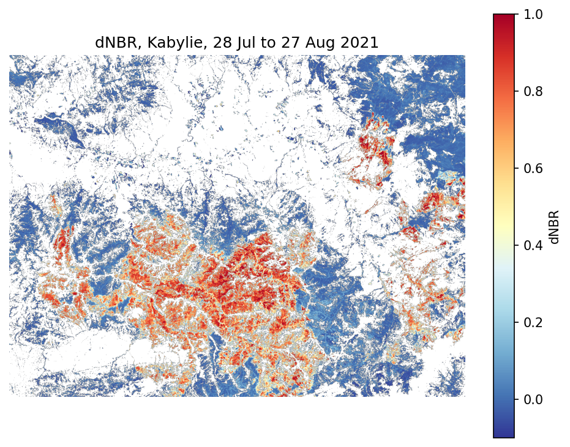

# TerraAlert: Wildfire Damage Mapping from Sentinel-2

**Team:** TerraAlert | **Theme:** Climate-induced Disasters | **Challenge:** Arab Youth Space Hackathon, 813

**Summary:** A reproducible notebook that maps burned vegetation after a wildfire by comparing two Sentinel-2 images (before and after), computes the burned area and a severity breakdown, and checks the result against an independent MODIS burned-area product. Case study: Kabylie, Algeria, August 2021.

## 1. Business use case
The user is a civil protection or forestry agency that needs to know, after a large fire, where the damage is concentrated and how large it is. The decision is where to send field teams first and how to plan recovery. Mapping over mountain terrain is slow to do on the ground, so this PoC produces a first map and a measured area directly from free satellite data. These are our assumptions about the user and have not been validated with an agency.

## 2. The problem
In August 2021, more than 100 fires broke out in the Kabylie region of Algeria. Fire extent and severity are needed quickly and over large, hard-to-reach areas. Satellite imagery covers the whole area at once, is free, and is revisited every few days, which makes it a good instrument for this task.

## 3. Data used
| Dataset | Provider | Dates | Level | Licence |
|---|---|---|---|---|
| Sentinel-2 (bands B8A, B12, scene classification) | Copernicus / ESA, via Earth Search STAC (Element 84) | 28 Jul 2021 (before), 27 Aug 2021 (after) | L2A (surface reflectance) | Free and open (Copernicus) |
| MODIS MCD64A1 v061, Burn Date (reference only) | NASA, via Microsoft Planetary Computer | August 2021, granule MCD64A1.A2021213.h18v05.061.2021309115547 | Level 3 | Open data (NASA) |

Sentinel-2 scenes used:
- 28 Jul 2021: S2A_31SEA_20210728_0_L2A, S2A_31SEA_20210728_1_L2A, S2A_31SFA_20210728_0_L2A, S2A_31SFA_20210728_1_L2A
- 27 Aug 2021: S2A_31SEA_20210827_0_L2A, S2A_31SEA_20210827_1_L2A, S2A_31SFA_20210827_0_L2A, S2A_31SFA_20210827_1_L2A

Area of interest: bounding box [4.0, 36.5, 4.5, 36.8] (lon/lat, EPSG:4326), 20 m grid.

**Hyperspectral data is not used in this PoC.** Sentinel-2 is multispectral (13 bands).

## 4. Technical approach
1. Search the Sentinel-2 L2A collection for the two dates and load B8A (near-infrared), B12 (shortwave infrared) and the scene classification (SCL), mosaicking the tiles.
2. Compute NBR = (B8A - B12) / (B8A + B12) for each date.
3. Compute dNBR = NBR(before) - NBR(after).
4. Keep only eligible pixels: vegetation in the before image (SCL class 4) and clear in the after image (no cloud, shadow, snow or water classes).
5. Flag a pixel as burned if dNBR >= 0.27. Each pixel is 400 m2.
6. Split burned pixels into severity classes with generic USGS-style thresholds (0.10, 0.27, 0.44, 0.66).
7. Compare the burned mask with MODIS MCD64A1 burn dates between day 213 and day 239 of 2021 (1 to 27 Aug), resampled to 20 m.

## 5. Installation
Python 3.13.

```bash
pip install -r requirements.txt
```
No credentials or accounts are needed.

## 6. How to run
Open `notebooks/02_main_analysis.ipynb` and run all cells from the top (Colab or Jupyter). The notebook downloads the needed pixels from the cloud, so an internet connection is required. Nothing needs to be edited. Expected outputs: the burned area in km2, a dNBR map, a severity table and validation scores, saved in `results/`.

## 7. Example input and output
- **Input:** the scenes listed in section 3, streamed from the STAC catalogue (no local sample file, the notebook downloads the exact scenes by date and bounding box).
- **Output:** `results/dnbr_map.png`, `results/severity_areas.csv`, `results/validation.csv`.



| Class | Area (km2) |
|---|---|
| Low | 29.37 |
| Moderate-low | 33.56 |
| Moderate-high | 63.34 |
| High | 111.08 |

## 8. Results and limitations
**Headline result:** 207.99 km2 of burned vegetation detected, out of 562.38 km2 of eligible vegetation (the rest was excluded as non-vegetation, cloud, shadow or water).

**Validation:** compared with MODIS MCD64A1 on eligible pixels only.

| Metric | Value |
|---|---|
| MODIS reference area | 237.42 km2 |
| Detected area | 207.99 km2 |
| IoU | 0.814 |
| Precision | 0.961 |
| Recall | 0.842 |

**Limitations:**
- This measures agreement with another satellite product, not field accuracy. MODIS has a 500 m resolution while our analysis uses 20 m, so edges do not match exactly.
- The 4-week gap between images includes natural seasonal drying, which slightly raises dNBR.
- Steep terrain and shadows affect reflectance.
- Severity thresholds are generic and not calibrated locally.
- One event and one area, with an approximate bounding box.
- Not tested on other fires, and no field data.

## 9. Next steps
Validate on more fires and with field or higher-resolution reference data, calibrate the thresholds locally, add terrain-shadow screening, and deliver results as an automatic report or alert for civil protection.

## 10. Licence and acknowledgements
Code under the MIT licence (see `LICENSE`). Data: contains modified Copernicus Sentinel data (2021); MODIS MCD64A1 courtesy of NASA.
